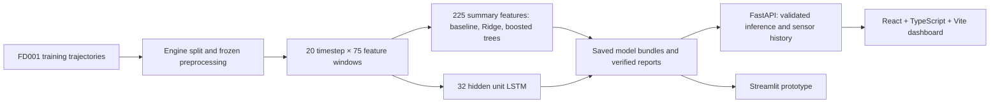

# AEVORA — Predictive Maintenance Intelligence

**Intelligence Before Failure.**

AEVORA estimates turbofan Remaining Useful Life (RUL) in operating cycles from
historical sensor measurements. It explores how maintenance teams could review
concerning estimates and prioritize inspection. It is a **research demonstration
on NASA C-MAPSS FD001**, not a live fleet or a validated maintenance system.

The React dashboard connects to a FastAPI service that runs existing saved Python
models with frozen training-time preprocessing. It never trains on a dashboard
request. The original Streamlit prototype remains available.

## Verified development-validation results

All four models use the same **3,472 observations from 20 validation engines**.
Values below were rechecked from saved endpoint predictions and labels during
Phase 8. Training uses 80 separate engines; overlapping windows are correlated.

| Model | MAE (cycles) | RMSE (cycles) | R² | Within ±10 cycles | Within ±20 cycles |
|---|---:|---:|---:|---:|---:|
| Median baseline | 46.41 | 54.85 | -0.013 | 12.10% | 23.62% |
| Ridge | 27.48 | 33.60 | 0.620 | 22.21% | 42.80% |
| Boosted trees | 20.54 | 28.72 | 0.722 | 42.08% | 62.24% |
| LSTM | 23.11 | 32.26 | 0.650 | 38.62% | 59.39% |

Boosted trees have the best aggregate MAE/RMSE in this development run, but mean
overprediction is **9.83 cycles** and the largest overprediction is **108.47
cycles**. Ridge produced 207 negative estimates; boosted trees produced 10.
Negative outputs are retained in evaluation and marked invalid in the UI.

Validation was used for model selection and LSTM early stopping. These are
**not independent test results** and do not establish production readiness.
Official test RUL targets have not been used in this release audit. R² is not
classification accuracy. See the [performance audit](docs/model_performance_audit.md)
and [reliability findings](docs/phase6_reliability.md).

## Architecture



Pages: Overview, Engine Explorer, Model Comparison, Reliability Insights and Data
Information. Engine/model selection, Run prediction, real sensor-history charts,
raw RUL, qualified guidance, and loading/error states use actual backend data.
The turbine picture is explicitly labelled AI-generated illustrative imagery.
Status thresholds are editable demonstration bands, not validated safety limits.
Hours conversion is optional and requires a user-supplied verified operating rate.

## Install and run

From a checkout of this repository:

```bash
python3 -m venv .venv
.venv/bin/python -m pip install -e '.[api,dev]'
cd frontend
npm ci
cd ..
```

Python requirement: **3.11+**. Vite requires **Node 20.19+ within Node 20, or
Node 22.12+**. This checkout was tested with Python 3.13.1 and Node 25.2.0.
`pyproject.toml` supplies Python dependency ranges; `frontend/package-lock.json`
locks frontend dependencies. A fresh-machine installation has not been verified.
See the [release report](docs/release_readiness.md) for the observed environment.

**A checkout alone cannot run inference.** Restore the matching trusted local
Phase 3–6 model/preprocessing/report bundle under `artifacts/` and FD001 training
trajectories under `data/raw/CMAPSSData/`. These are intentionally Git-ignored.
See [artifact setup](docs/release_readiness.md#artifact-setup) for restoration and
explicit regeneration instructions. No API keys or cloud services are required.

Terminal 1, repository root:

```bash
PYTHONPATH=src OPENBLAS_NUM_THREADS=2 OMP_NUM_THREADS=2 .venv/bin/python -m uvicorn aevora.api.app:app --host 127.0.0.1 --port 8000
```

Terminal 2, repository root:

```bash
cd frontend
npm run dev
```

Open **http://127.0.0.1:5173**. Health: **http://127.0.0.1:8000/api/health**.
Vite forwards `/api` requests to port 8000. Models and assets work offline after
installation. These are local development servers; the static production build
alone does not configure a production API proxy. Full endpoint documentation and
troubleshooting: [web dashboard guide](docs/web_dashboard.md).

Optional Streamlit prototype:

```bash
OPENBLAS_NUM_THREADS=2 OMP_NUM_THREADS=2 .venv/bin/python -m streamlit run dashboard.py --server.address 127.0.0.1
```

## Verification

```bash
PYTHONPATH=src OPENBLAS_NUM_THREADS=2 OMP_NUM_THREADS=2 .venv/bin/python -W error -m unittest discover -s tests -v
npm test --prefix frontend
npm run build --prefix frontend
npm run format --prefix frontend
```

Build includes strict TypeScript checks; formatting uses Prettier. ESLint is not
configured. Some Python integration tests require the local audited bundle and
explicitly skip when absent. Tests train small synthetic fixtures only; the
release audit does not retrain benchmark models.

Read [Phase 8 evidence and release checklist](docs/release_readiness.md) before
claiming full end-to-end verification. Live server/browser checks remain manual
where sandbox restrictions prohibit opening local ports. No mockup is presented
as an application screenshot.

## Repository and further reading

- `frontend/`: React UI, local brand assets and UI tests.
- `src/aevora/api/`: FastAPI routes and artifact-backed service.
- `src/aevora/`: data validation, features, preprocessing, models and audits.
- `configs/default.toml`: paths, seed, split and model configuration.
- `tests/`: Python unit and integration tests.
- `data/`, `artifacts/`: local, ignored data and model/report bundles.
- [Dataset acquisition](docs/dataset.md), [preparation](docs/preparation.md),
  [classical models](docs/classical_models.md), [LSTM](docs/lstm.md),
  [architecture contracts](docs/architecture.md).

Before industrial use, evaluate frozen choices on untouched data, assess engine-
level uncertainty, validate on representative field equipment, calibrate any
operational thresholds, and establish human review, monitoring and security.
The current noise probe is sensitivity analysis, not calibrated uncertainty.
